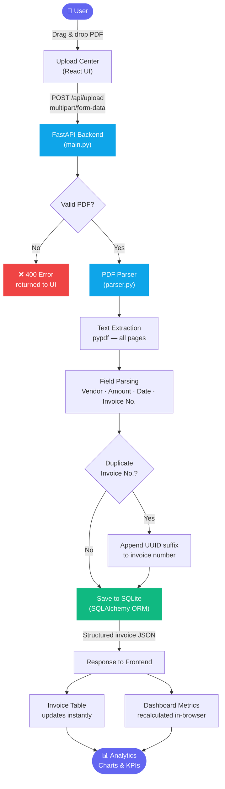
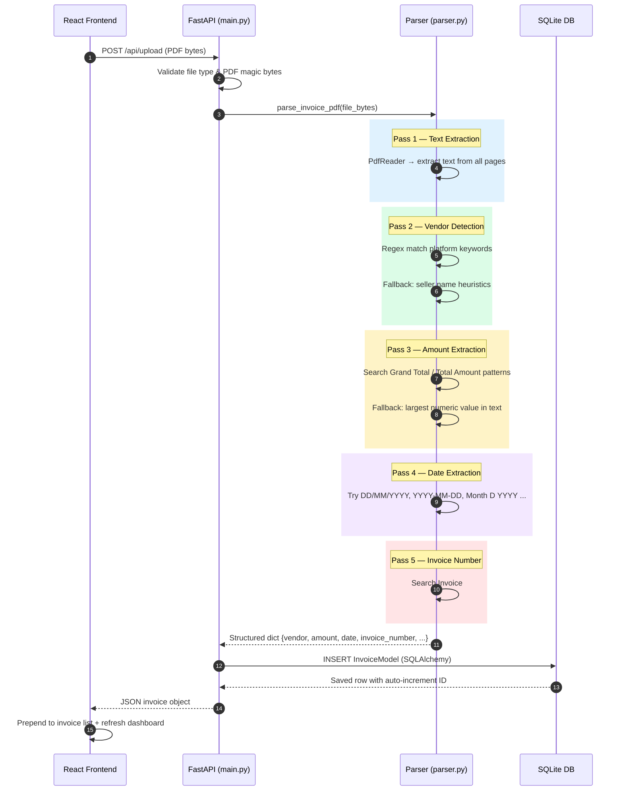

# InvoIQ — Invoice Intelligence

> **Automated invoice ingestion, parsing, and analytics for modern finance teams.**

InvoIQ is a full-stack SaaS application that lets you upload PDF invoices, automatically extract key data (vendor, amount, date, invoice number), and visualise spend trends through a live analytics dashboard — all with zero manual data entry.

---

## ✨ Features

| Feature | Description |
|---|---|
| **PDF Upload & Parsing** | Drag-and-drop PDF invoices; structured data is extracted instantly using a regex + heuristic Python parser |
| **Vendor Detection** | Recognises 15 + Indian e-commerce and quick-commerce platforms automatically (Amazon India, Flipkart, Swiggy, Zomato, Blinkit, Meesho, Myntra, Zepto, Nykaa, and more) |
| **Live Dashboard** | Metric cards (total spend, invoices processed, active vendors, average invoice value) update in real time |
| **Spend Charts** | Monthly spend bar chart and top-5 vendor spend breakdown powered by Recharts |
| **Invoice Table** | Searchable, sortable table of all processed invoices with delete support |
| **Search** | Global search bar filters the dashboard and invoice list by vendor, invoice ID, status, or date |
| **Persistent Storage** | SQLite database via SQLAlchemy; survives server restarts |

---

## ⚙️ How It Works

### End-to-End Pipeline



---

### Parser Pipeline (Detailed)



---

## 🏗️ Architecture

```
InvoIQ/
├── backend/                  # Python FastAPI service
│   ├── main.py               # REST API routes (/api/upload, /api/invoices, /api/analytics)
│   ├── parser.py             # PDF text extraction & field parsing logic
│   ├── models.py             # SQLAlchemy ORM model (InvoiceModel)
│   ├── database.py           # SQLite engine & session factory
│   └── test_parser.py        # Unit tests for the parser
│
├── src/                      # React + TypeScript frontend (Vite)
│   ├── App.tsx               # Root layout — routing, global state, search
│   ├── components/
│   │   ├── layout/
│   │   │   ├── Header.tsx    # Sticky header with conditional search bar
│   │   │   └── Sidebar.tsx   # Navigation sidebar
│   │   ├── dashboard/
│   │   │   ├── Dashboard.tsx # Analytics view (filtered by search)
│   │   │   ├── MetricCards.tsx
│   │   │   └── Charts.tsx
│   │   ├── invoices/
│   │   │   └── InvoicesTable.tsx
│   │   └── upload/
│   │       └── UploadCenter.tsx
│   ├── services/api.ts       # Axios API client
│   └── types.ts              # Shared TypeScript types
│
├── start-backend.bat         # One-click backend launcher (Windows)
└── index.html
```

---

## 🚀 Getting Started

### Prerequisites

- **Node.js** >= 18
- **Python** >= 3.10
- `pip` / `venv`

---

### 1 — Backend (FastAPI)

```bash
# Create and activate a virtual environment
cd backend
python -m venv venv

# Windows
venv\Scripts\activate

# macOS / Linux
source venv/bin/activate

# Install dependencies
pip install fastapi uvicorn sqlalchemy pypdf python-multipart

# Start the API server
uvicorn main:app --reload --port 8000
```

> **Windows shortcut:** double-click `start-backend.bat` in the project root.

The API will be available at `http://localhost:8000`.
Interactive docs: `http://localhost:8000/docs`

---

### 2 — Frontend (React + Vite)

```bash
# From project root
npm install
npm run dev
```

The app will open at `http://localhost:5173`.

---

## API Reference

| Method | Endpoint | Description |
|---|---|---|
| `GET` | `/` | Health check & endpoint map |
| `GET` | `/health` | Liveness probe |
| `POST` | `/api/upload` | Upload a PDF invoice; returns parsed invoice object |
| `GET` | `/api/invoices` | Fetch all stored invoices |
| `DELETE` | `/api/invoices/{id}` | Delete an invoice by ID or invoice number |
| `GET` | `/api/analytics` | Aggregated metrics, monthly spend, and vendor breakdown |

## Tech Stack

### Frontend
- **React 18** + **TypeScript**
- **Vite 7** — development server & build tool
- **Tailwind CSS 3** — utility-first styling
- **Recharts** — dashboard charts
- **Lucide React** — icon set
- **Axios** — HTTP client

### Backend
- **FastAPI** — async REST API
- **pypdf** — PDF text extraction
- **SQLAlchemy** + **SQLite** — ORM and local persistence
- **Uvicorn** — ASGI server

---

## Invoice Parser

The Python parser (`backend/parser.py`) uses a multi-pass heuristic approach:

1. **Text extraction** — `pypdf` pulls raw text from all PDF pages
2. **Vendor detection** — regex patterns matched against known platform keywords
3. **Amount extraction** — searches for *Grand Total*, *Total Amount*, *Amount Due* patterns; falls back to the largest numeric value found
4. **Date extraction** — recognises `DD/MM/YYYY`, `YYYY-MM-DD`, `Month DD, YYYY`, and other common formats
5. **Invoice number** — looks for `Invoice #`, `Bill No`, `Tax Invoice` labels and adjacent identifiers

Supported vendor auto-detection: Amazon India, Flipkart, Meesho, Myntra, Blinkit, Swiggy, Zepto, Zomato, Nykaa, Tata Cliq, JioMart, BigBasket, Paytm Mall, Snapdeal, Ajio, and generic fallback via seller-name heuristics.

---

## Database

InvoIQ uses a local **SQLite** database (`backend/docuflow.db`). The file is excluded from version control via `.gitignore`.

| Column | Type | Description |
|---|---|---|
| `id` | Integer PK | Auto-increment primary key |
| `invoice_number` | String | Parsed invoice / bill number |
| `vendor_name` | String | Detected vendor |
| `invoice_date` | String | Parsed date string |
| `total_amount` | Float | Grand total in base currency |
| `currency` | String | Detected currency (default INR) |
| `status` | String | `Processed` / `Failed` |
| `created_at` | DateTime | Server-side insertion timestamp |

---

## License

MIT 2024 InvoIQ
